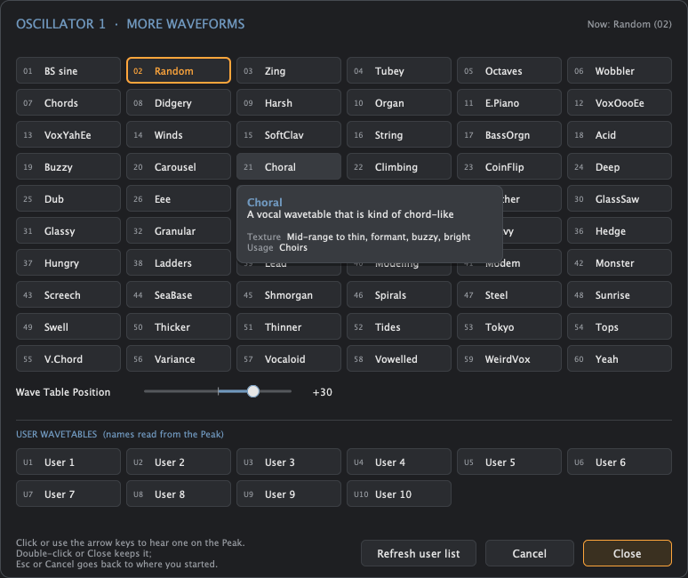
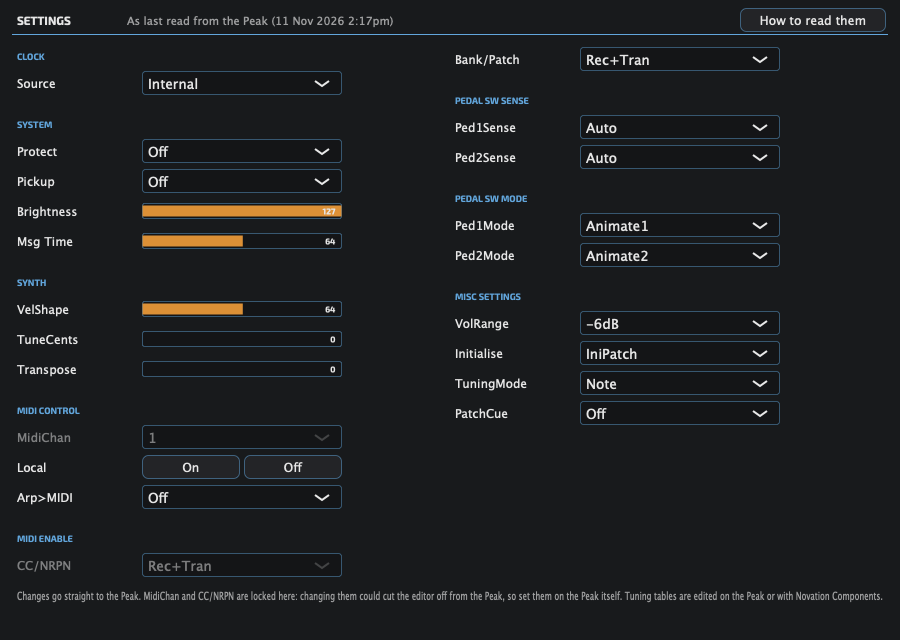

# Peak Editor

An editor and librarian for the **Novation Peak** (firmware 2.2), as a standalone Mac app and AU/VST3 plugins.
The front panel is drawn from the hardware and every control works both ways: turn a knob in the editor and the
Peak follows; turn one on the Peak and the editor follows.


- **Platform:** macOS 12 or later, Universal (Apple Silicon and Intel)
- **Formats:** standalone app, Audio Unit, VST3
- **Synth:** Novation Peak, firmware 2.2 (connected by USB, DIN MIDI or a network MIDI session)
- **Latest release:** [Releases](../../releases) (zips plus an installer script)

---

## Contents
- [Features](#features)
- [Installing](#installing)
- [Setting up the Peak](#setting-up-the-peak)
- [Using the editor](#using-the-editor)
- [Where things are kept](#where-things-are-kept)
- [Known limitations](#known-limitations)
- [Building from source](#building-from-source)
- [How it talks to the Peak](#how-it-talks-to-the-peak)
- [Credits](#credits)

---

## Features

**Front panel**
- Every knob, slider, LED and switch of the Peak, laid out from a photo of the hardware, including the
  PEAK lettering.
- A large screen showing the patch's slot, name and category, with a favourite star. Click the category to change
  it, which saves it straight away. Double-click the name to rename the patch.
- While a control moves, the screen shows its value and saved value. **Envelope and filter controls show a graph**
  of the envelope or the filter's response.
- **Bank −/+ and Patch −/+** step through Peak banks A–D, then My Banks. The arrow keys do the same:
  Left/Right for patches, Up/Down for banks.
- **Animate 1/2** are momentary, and latch with Hold.
- **Panic** (under Hold) sends All Notes Off and releases every held key. **Patch Volume** sets the patch's level
  (the Mixer menu's Patch Level), which is saved with the patch.
- Oscillator **Coarse** reads in semitones, −12.0 to +12.0, as on the Peak.
- Double-click any value to put it back as saved in the patch.


**Menus**: Osc, Env, LFO, Arp/Clock, Animate, Voice, FX
- Every setting without a knob on the panel, laid out in cards. Named values (sync rates, wavetables, arp types,
  FX routing and so on) are drop-downs.
- **Arp/Clock** includes Clock Rate (stored in the patch), the clock Source and the status line, as the Peak
  shows them.


**Wavetable picker**
- Choosing **More** on an oscillator opens a picker with all **60 factory and 10 user wavetables**. The user
  tables' names are read from the Peak.
- Clicking a wavetable, or using the arrow keys, auditions it on the Peak straight away.
- Hover over a factory wavetable to see notes on its sound, texture and uses.
- **Wave Table Position** moves through the wavetable (the oscillator's Shape Amount).



**Modulation**
- The **Mod Matrix** tab shows all 16 slots (Source A × Source B → Depth → Destination) and the 4 FX slots, with
  Undo/Redo.
- **Right-click any control** to modulate it:
  - **Modulate ‹X› from** a source, on its own or scaled by a controller (Source B).
  - See the slots that already modulate it.
  - On an LFO, envelope or Animate control, **send** that source somewhere, or use it to scale an existing slot.
  - The Mod Matrix then opens on the slot, outlined.


**Library**
- **Peak banks A–D** next to **My Banks** (your own library of imported `.syx` files and saved patches).
- **Fetch** reads banks straight from the Peak, at about 2 seconds a bank.
- **Moving patches:** drag patches between banks; dragging within the Peak swaps them. Changes are marked
  **NOT SENT** until **Save all changes** writes them. Each bank is backed up first, then the editor reads it
  back to check every write landed.
- **Save** works like the TEO-5 and OB-6 editors. The Library becomes a picker: click a slot to hear what's
  there, then Confirm or Cancel.
- **Startup:** the editor loads whatever the Peak is playing, checks the Peak's memory against its own copy, and
  warns you if something changed outside the editor (for example in Novation Components). It saves its old copy
  first.
- Search, category filter, favourites, export and Undo/Redo.


**Wavetables**
- Draw and edit the Peak's **user wavetables** (U1–U10): 5 waves each, with Pencil, Line and shape drawing
  (click a shape and drag a box; double-click to fill the wave), Snap to grid, harmonic level and phase bars,
  Copy to all, Blend 1 → 5, Normalise, Reverse, Invert, Reset and Undo/Redo.
- **Load from Peak** reads a user slot; **Send to Peak** plays it at once. **Live Edit** sends every change, and
  clicking a wave or moving Wave Table Position moves the Peak there.
- A sent wavetable is kept only once it's **saved on the Peak** (Osc menu, page 9 "User Waves", Save); the slot is
  marked "unsaved on Peak" until you say you have.
- Drag a wave onto another to swap them.
- **File Browser:** add folders (chosen in Finder) to its Home list, browse them with Back, Forward, Up and Home,
  and double-click to load. Wavetables with fewer than five frames fill the first waves and leave the rest flat. It lists what
  Components imports: `.syx`/`.sysex` wavetables (loaded at once), and WAV or MP3 files, loaded either as a
  wavetable (single cycle or 2048-sample frames, e.g. Serum) or as an **audio sample**: play and scrub through it,
  pick a point, then **Import Waveform** (one cycle into the selected wave) or **Import Wavetable** (five successive
  cycles into all five waves). **Import…** opens a single file from anywhere; **Save** writes a `.syx` that
  Components can load. The **?** explains the rest.

**Settings**
- The Peak's global settings (Clock Source, Brightness, pedals, MIDI and so on), read from the Peak and written
  back to it.



**Plugin (AU/VST3)**
- **Track MIDI → Peak:** play the Peak from the DAW track.
- **DAW clock → Peak:** send the DAW's tempo and Start/Stop as MIDI clock.
- Every parameter can be automated, and the project remembers its patch.

---

## Installing

Download the zips and **install-peak-editor.sh** from the [latest release](../../releases) into one folder
(Downloads is fine), then run in Terminal:

```bash
bash ~/Downloads/install-peak-editor.sh
```

**What the script does:**
- installs **Peak Editor.app** in `/Applications`;
- installs the AU in `~/Library/Audio/Plug-Ins/Components` and the VST3 in `~/Library/Audio/Plug-Ins/VST3`;
- replaces any earlier version;
- clears the macOS quarantine flag, so there's no "can't be opened" warning;
- refreshes the AU list.

Add `--dry-run` to see what it would do first.

**By hand:** unzip each file and copy it to the same places. Because the builds aren't notarized by Apple,
right-click the app and choose **Open** the first time, or run:

```bash
xattr -dr com.apple.quarantine "/Applications/Peak Editor.app"
```

Do the same for the plugins.

---

## Setting up the Peak

1. **Connect the Peak** by USB, by DIN MIDI through an interface, or over a network MIDI session.
2. **On the Peak, open Settings:**
   - **MIDI Enable > CC/NRPN** must be **Receive** or **Rec+Tran**. Rec+Tran is needed for the editor to follow
     the Peak's knobs.
   - **MIDI Enable > Bank/Patch** set to **Rec+Tran** lets the editor follow patch changes made on the Peak.
   - Note the Peak's **MIDI channel**.
3. **In the editor, open the MIDI tab** and choose the Peak's input and output ports and the same
   channel.

When the editor opens, it asks the Peak for its current sound, its settings and the user wavetable names, then
checks its stored banks against the Peak.

---

## Using the editor

| To… | Do this |
|---|---|
| Change a value | Drag a knob or slider (or scroll over a panel knob). Values in the menus change by dragging only. |
| Put a value back as saved | Double-click it (for a drop-down, double-click its name) |
| Modulate a control | Right-click it |
| Change patch / bank | Patch −/+ and Bank −/+, or ←/→ and ↑/↓ on the Front Panel tab |
| Save | **Save**, choose a slot in the Library, then **Confirm** |
| Undo your edits | **Revert**, or **Compare** to hear the saved version |
| Rename | Double-click the name on the screen |
| Change the category | Click the category on the screen (saved straight away) |
| Favourite | Click the star next to the name |
| Show/hide the keyboard | The **Keyboard** switch under the panel |
| Help | The **?** at the top left of the panel, the Library and the Wavetables tab |

---

## Where things are kept

Everything lives in `~/Library/Application Support/Peak Editor/`:

- `Library/`: My Banks, one `.syx` per patch, plus `index.json`.
- `Peak Banks/`: the editor's copy of Peak banks A–D, NOT SENT changes and the global settings.
- `Backups/`: banks saved automatically before each write to the Peak, and before the copy is updated when the
  Peak changed outside the editor.

---

## Known limitations

- **Not notarized:** the builds are only ad-hoc signed, so macOS needs the installer script or right-click → Open
  the first time.
- **Estimated graph scales:** the envelope and filter graphs use estimated scales (about 1 ms to 10 s, and
  20 Hz to 20 kHz), because Novation doesn't publish the Peak's.
- **Master Volume:** the Peak ignores MIDI volume, so the editor has no master volume (Patch Volume sets each
  patch's own level).
- **Clock status:** the Peak doesn't report whether it's locked to an external clock. The status line follows
  the Source setting and, in the plugin, the DAW clock it sends.
- **External changes:** the Peak doesn't announce memory changes made by other software. The editor checks at
  startup and whenever the Peak selects a slot.

---

## Building from source

**You'll need** Xcode (with the command-line tools) and CMake 3.22 or later. JUCE 9.0.5 is fetched
automatically.

```bash
cmake -S . -B build -G Xcode
cmake --build build --config Release
```

**Outputs** go to `build/PeakEditor_artefacts/Release/`: `Standalone/Peak Editor.app`, `AU/` and `VST3/`.
Add `-DPEAK_COPY_PLUGINS=ON` to copy the plugins into `~/Library/Audio/Plug-Ins` after each build.

**Tests**

```bash
./build/Release/PeakCoreTests     # patch format, MIDI, parameter names, requests
./build/LibraryTests_artefacts/Release/LibraryTests
```

`PanelSnapshot` renders the panel, menus and tabs to PNG (it made the screenshots here). For example:
`PanelSnapshot out.png 2191 patch.syx filter_frequency=120`.

**Source layout**
- `Source/peak/core`: the Peak's patch format, parameter table, MIDI and SysEx. Plain C++, tested.
- `Source/peak`: the MIDI connection (CoreMIDI), the model and the library.
- `Source/ui`: the front panel, cards, Library, Mod Matrix, Settings and graphs.
- `tools`: the parameter table generator, the panel measuring scripts and the installer script.

---

## How it talks to the Peak

The protocol details were worked out on the hardware and are recorded in
[docs/sysex-notes.md](docs/sysex-notes.md). The parameter map is in
[docs/peak-patch-map.json](docs/peak-patch-map.json). In short:

- **Parameters:** CC, CC pairs and NRPN, as in the Peak's MIDI chart.
- **Patches:** 527-byte dumps, one 7-bit value per byte.
- **Dump requests** (header `F0 00 20 29 01 10 00 7E`, then a command): `40` the current sound, `41` a stored
  slot, `44` the global settings, `47` a wavetable's name.
- **Global settings** go back as a whole settings dump; the Peak ignores them sent one at a time.
- **User wavetables:** `46` reads one wave of a user slot; uploads are a name (`07`) and 5 waves (`06`), each a
  spectrum (an offset, then a cosine and sine part for harmonics 1–128).
- **Changes the Peak doesn't announce** (its Initialise, for one) are picked up by quietly asking for the current
  sound every couple of seconds when nothing else is going on.
- **Animate** is CC 114/115 with 127 for pressed and 0 for released.
- **Clock Rate** is stored in the patch and has no MIDI message of its own.

---

## Credits

- Built with [JUCE](https://juce.com).
- Wavetable notes come from the "Novation Peak/Summit factory wavetable list" posted on r/synthesizers.
- Novation and Peak are trademarks of Focusrite Audio Engineering Ltd. This is an independent project, not
  affiliated with or endorsed by Novation.
