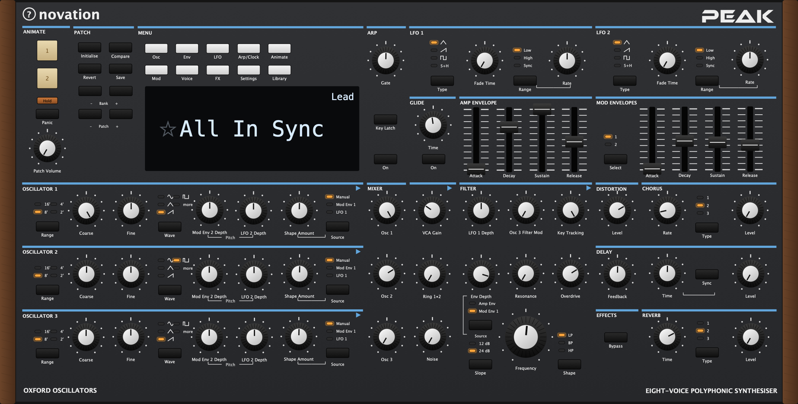
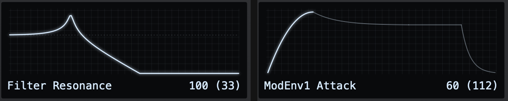
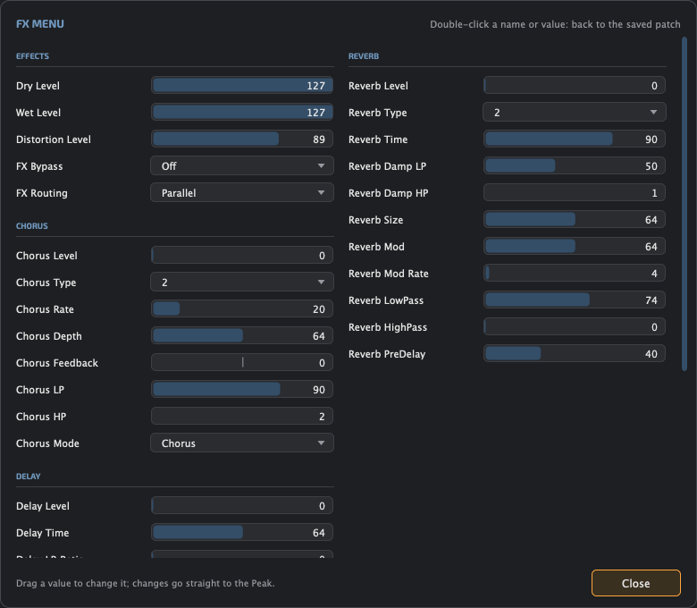
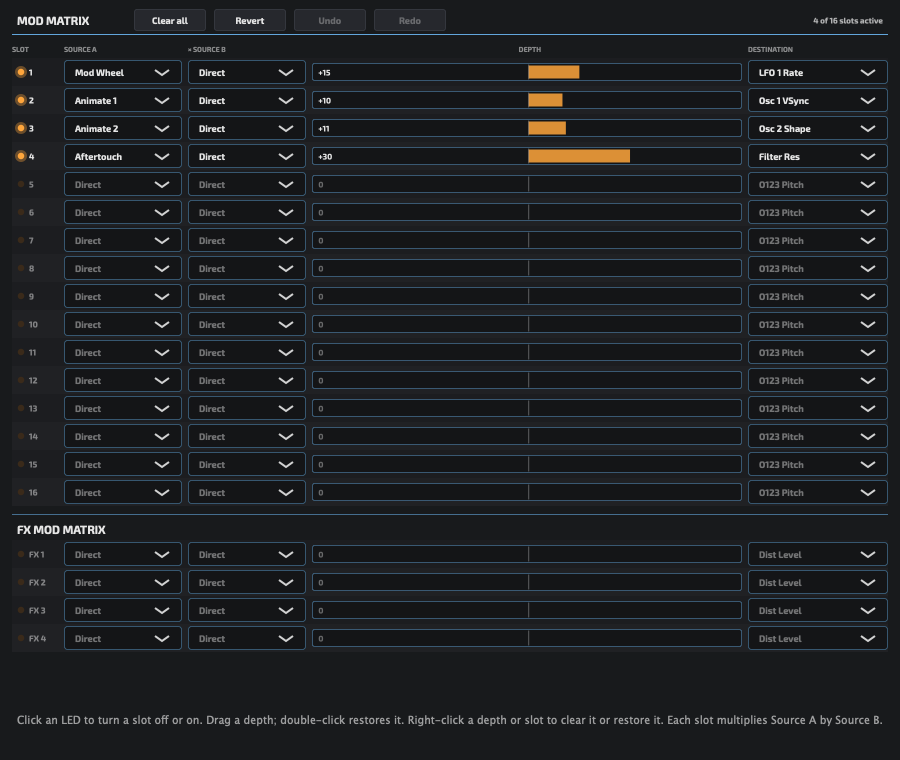
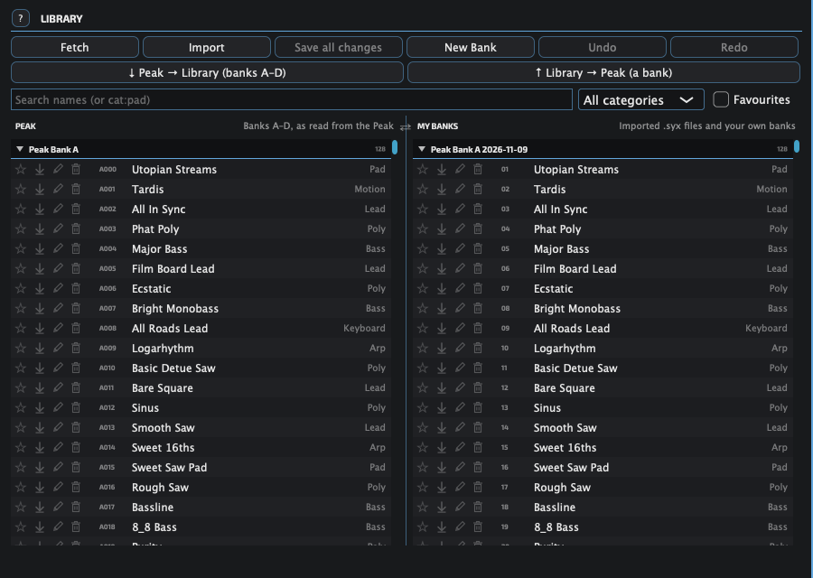
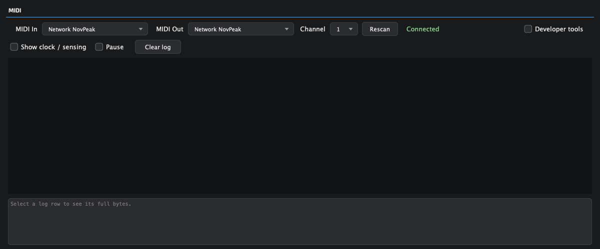
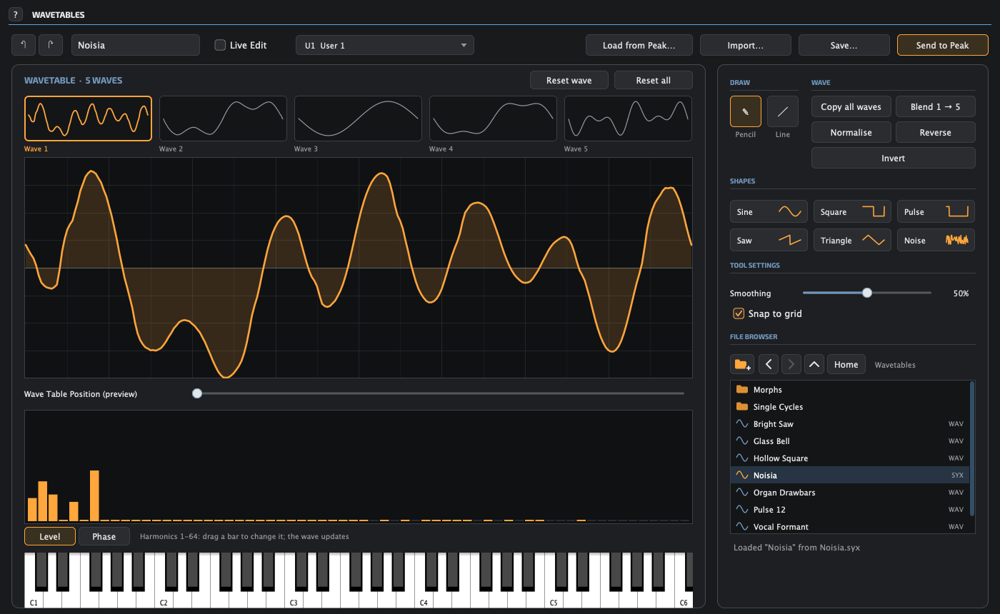
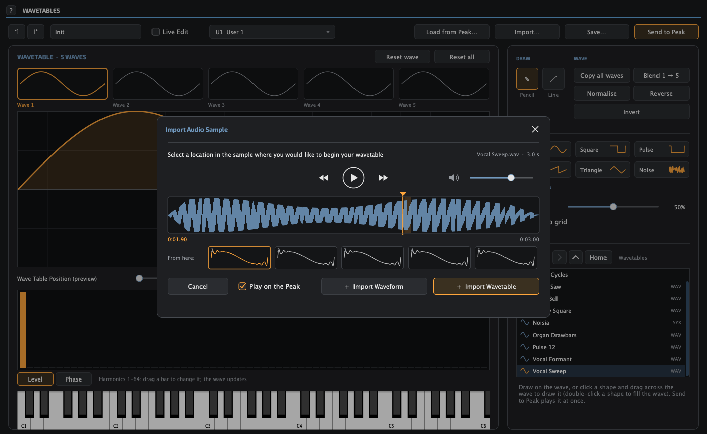
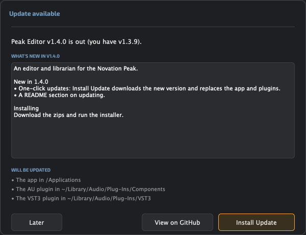

# Peak Editor

An editor and librarian for the **Novation Peak** (firmware 2.2), as a standalone Mac app and AU/VST3 plugins.
The front panel is drawn from the hardware and every control works both ways: turn a knob in the editor and the
Peak follows; turn one on the Peak and the editor follows.



- **Platform:** macOS 12 or later, Universal (Apple Silicon and Intel)
- **Formats:** standalone app, Audio Unit, VST3
- **Synth:** Novation Peak, firmware 2.2 (connected by USB, DIN MIDI or a network MIDI session)
- **Latest release:** [Releases](../../releases) (zips plus an installer script). When a newer one is out, the
  editor says so at the bottom left: click it to see what's new and **Install Update** (it replaces the app and
  plugins, then Relaunch).
- **Price:** free. A hobby project, offered as is.

---

## Contents
- [Features](#features)
- [Wavetable editor](#wavetable-editor)
- [Installing](#installing)
- [Updating](#updating)
- [Setting up the Peak](#setting-up-the-peak)
- [Using the editor](#using-the-editor)
- [Where things are kept](#where-things-are-kept)
- [Known limitations](#known-limitations)
- [Building from source](#building-from-source)
- [How it talks to the Peak](#how-it-talks-to-the-peak)
- [Licence](#licence)
- [Credits](#credits)

---

## Features

**Front panel**
- Every knob, slider, LED and switch of the Peak, laid out from a photo of the hardware, including the
  PEAK lettering.
- A large screen showing the patch's slot, name and category, with a favourite star. Click the category to change
  it, which saves it straight away. Double-click the name to rename the patch.
- While a control moves, the screen shows its value and saved value. **Envelope and filter controls show a graph**
  of the envelope or the filter's response.
- **Bank −/+ and Patch −/+** step through Peak banks A–D, then My Banks. The arrow keys do the same:
  Left/Right for patches, Up/Down for banks.
- **Animate 1/2** are momentary, and latch with Hold.
- **Panic** (under Hold) sends All Notes Off and releases every held key. **Patch Volume** sets the patch's level
  (the Mixer menu's Patch Level), which is saved with the patch.
- Oscillator **Coarse** reads in semitones, −12.0 to +12.0, as on the Peak.
- Double-click any value to put it back as saved in the patch.
- Changes made on the Peak that it doesn't send over MIDI (its **Initialise**, for one) still show up: the editor
  quietly checks the Peak's sound every couple of seconds when nothing else is going on.

**Keyboard strip** (under the panel; the **Keyboard** switch shows or hides it)
- Play the Peak with the mouse or the computer keyboard, with Octave −/+ and Velocity.
- **Keyboard in:** a MIDI controller whose notes, bend, mod wheel, aftertouch and sustain go to the Peak.
- The **pitch and mod wheels** move with any wheel: your controller's, the DAW track's, or the Peak's own.



**Menus**: Osc, Env, LFO, Arp/Clock, Animate, Voice, FX
- Every setting without a knob on the panel, laid out in cards. Named values (sync rates, wavetables, arp types,
  FX routing and so on) are drop-downs.
- **Arp/Clock** includes Clock Rate (stored in the patch), the clock Source and the status line, as the Peak
  shows them.



**Wavetable picker**
- Choosing **More** on an oscillator opens a picker with all **60 factory and 10 user wavetables**. The user
  tables' names are read from the Peak.
- Clicking a wavetable, or using the arrow keys, auditions it on the Peak straight away.
- Hover over a factory wavetable to see notes on its sound, texture and uses.
- **Wave Table Position** moves through the wavetable (the oscillator's Shape Amount).


**Modulation**
- The **Mod Matrix** tab shows all 16 slots (Source A × Source B → Depth → Destination) and the 4 FX slots, with
  Undo/Redo.
- **Right-click any control** to modulate it:
  - **Modulate ‹X› from** a source, on its own or scaled by a controller (Source B).
  - See the slots that already modulate it.
  - On an LFO, envelope or Animate control, **send** that source somewhere, or use it to scale an existing slot.
  - The Mod Matrix then opens on the slot, outlined.



**Library**
- **Peak banks A–D** next to **My Banks** (your own library of imported `.syx` files and saved patches).
- **Fetch** reads banks straight from the Peak, at about 2 seconds a bank.
- **Moving patches:** drag patches between banks; dragging within the Peak swaps them. Changes are marked
  **NOT SENT** until **Save all changes** writes them. Each bank is backed up first, then the editor reads it
  back to check every write landed.
- **Save** works like the TEO-5 and OB-6 editors. The Library becomes a picker: click a slot to hear what's
  there, then Confirm or Cancel.
- **Startup:** the editor loads whatever the Peak is playing, checks the Peak's memory against its own copy, and
  warns you if something changed outside the editor (for example in Novation Components). It saves its old copy
  first.
- Search, category filter, favourites, export and Undo/Redo.



**Settings**
- The Peak's global settings (Clock Source, Brightness, pedals, MIDI and so on), read from the Peak and written
  back to it.


**MIDI**
- The Peak's MIDI ports and channel, the connection status, and a live log of everything sent and received.
- **Developer tools** (off by default) adds a raw CC and SysEx sender and saving captured SysEx, for exploring the
  Peak's protocol.



**Wavetables** — see [Wavetable editor](#wavetable-editor) below.

**Plugin (AU/VST3)**
- **Track MIDI → Peak:** play the Peak from the DAW track.
- **DAW clock → Peak:** send the DAW's tempo and Start/Stop as MIDI clock.
- Every parameter can be automated, and the project remembers its patch.
- **Keyboard in** starts at none in the plugins (the controller already reaches the Peak through the track), and
  is remembered separately from the app's.
- The plugin window opens where you last put it in that DAW.

---

## Wavetable editor

The **Wavetables** tab draws, edits and imports the Peak's ten **user wavetables** (U1–U10). Each has five waves;
the oscillator's Wave Table Position (Shape Amount) morphs through them. The **?** at the top left explains
everything in the tab.



**Editing**
- Click one of the five waves to edit it; **drag a wave onto another** to swap them.
- **Pencil** draws freehand (softened by **Smoothing**); **Line** draws straight lines.
- **Shapes:** click one (Sine, Square, Pulse, Saw, Triangle, Noise), then drag a box across the wave to draw one
  cycle of it there; start on the centre line to keep it in one half. Double-click a shape to fill the whole wave.
  **Snap to grid** snaps lines and shapes.
- The **harmonic bars** under the wave set the level, or the phase, of harmonics 1–64.
- **Copy all waves**, **Blend 1 → 5** (waves 2–4 morph between 1 and 5), **Normalise**, **Reverse**, **Invert**,
  **Reset wave**, **Reset all**, and Undo/Redo.
- **Wave Table Position** previews the morph, and follows the Peak's Shape Amount knob as you turn it.

**On the Peak**
- **Load from Peak** reads a user slot. **Send to Peak** sends the wavetable to the chosen slot, where it plays at
  once. **Live Edit** sends every change as you make it; clicking a wave or moving Wave Table Position moves the
  Peak there too.
- A sent wavetable is only **kept once you save it on the Peak**: Osc menu, page 9 "User Waves", select it, then
  that page's Save. The editor can't do this over MIDI, so the slot is marked "unsaved on Peak" until you click
  **I've saved it on the Peak**.

**File Browser**
- The folder button adds a folder (chosen in Finder) to the browser's **Home** list. Add as many as you like;
  they're remembered, and shared with the plugins. Right-click one at Home to remove it from the list.
- Browse with **Back**, **Forward**, **Up** and **Home**; double-click a file to load it.
- It lists what Novation Components imports: **`.syx`/`.sysex`** wavetables, which load straight in, and **WAV**
  and **MP3** files, which ask how to load them:
  - **Wavetable:** the file as it is. A single cycle goes into the selected wave; 2048-sample frames (Serum-style
    wavetables) fill the five waves, and with fewer than five frames the rest are left flat.
  - **Audio file…:** opens Import Audio Sample (below).
- **Import…** at the top opens a single file from anywhere, the same way. **Save…** writes a `.syx` file that
  Components can load too.

**Import Audio Sample**
- Play and scrub through a sample; **click the waveform to hear the cycle at that point**, and drag to scrub. A
  volume slider sets how loud it plays.
- **From here** shows the five waves the chosen point gives; click one to hear it and choose it.
- **Import Waveform** puts the chosen wave into the editor's selected wave. **Import Wavetable** fills all five
  waves with five successive cycles (512-sample slices) from that point.
- **Play on the Peak:** what you audition is also sent to the selected user slot, so you can play it from your
  keyboard. Close the window without importing and the Peak goes back to how it was.
- The sample plays through the editor's audio output: in the app, the audio device in its settings; as a plugin,
  the DAW track.



---

## Installing

Download the zips and **install-peak-editor.sh** from the [latest release](../../releases) into one folder
(Downloads is fine), then run in Terminal:

```bash
bash ~/Downloads/install-peak-editor.sh
```

**What the script does:**
- installs **Peak Editor.app** in `/Applications`;
- installs the AU in `~/Library/Audio/Plug-Ins/Components` and the VST3 in `~/Library/Audio/Plug-Ins/VST3`;
- replaces any earlier version;
- clears the macOS quarantine flag, so there's no "can't be opened" warning;
- refreshes the AU list.

Add `--dry-run` to see what it would do first.

**By hand:** unzip each file and copy it to the same places. Because the builds aren't notarized by Apple,
right-click the app and choose **Open** the first time, or run:

```bash
xattr -dr com.apple.quarantine "/Applications/Peak Editor.app"
```

Do the same for the plugins.

---

## Updating

When a newer release is out, the editor shows **Update available** at the bottom left (it asks GitHub once at
startup; nothing else is sent). Click it to see what's new, then **Install Update**: it downloads the new
version, checks it, and replaces the app and both plugins where they're installed. Then **Relaunch Now** (the
app), or reopen your DAW project (a plugin). Your library, settings and added folders are kept.



You can also install a new release by hand, as above.

---

## Setting up the Peak

1. **Connect the Peak** by USB, by DIN MIDI through an interface, or over a network MIDI session.
2. **On the Peak, open Settings:**
   - **MIDI Enable > CC/NRPN** must be **Receive** or **Rec+Tran**. Rec+Tran is needed for the editor to follow
     the Peak's knobs.
   - **MIDI Enable > Bank/Patch** set to **Rec+Tran** lets the editor follow patch changes made on the Peak.
   - Note the Peak's **MIDI channel**.
3. **In the editor, open the MIDI tab** and choose the Peak's input and output ports and the same
   channel.

When the editor opens, it asks the Peak for its current sound, its settings and the user wavetable names, then
checks its stored banks against the Peak.

---

## Using the editor

| To… | Do this |
|---|---|
| Change a value | Drag a knob or slider (or scroll over a panel knob). Values in the menus change by dragging only. |
| Put a value back as saved | Double-click it (for a drop-down, double-click its name) |
| Modulate a control | Right-click it |
| Change patch / bank | Patch −/+ and Bank −/+, or ←/→ and ↑/↓ on the Front Panel tab |
| Save | **Save**, choose a slot in the Library, then **Confirm** |
| Undo your edits | **Revert**, or **Compare** to hear the saved version |
| Rename | Double-click the name on the screen |
| Change the category | Click the category on the screen (saved straight away) |
| Favourite | Click the star next to the name |
| Show/hide the keyboard | The **Keyboard** switch under the panel |
| Load a wavetable file | Wavetables tab: add its folder in the File Browser, then double-click the file |
| Hear a wavetable on the Peak | **Send to Peak** (or turn on **Live Edit**), with an oscillator playing that user slot |
| Keep a wavetable on the Peak | On the Peak: Osc menu, page 9 "User Waves", select it, Save |
| Help | The **?** at the top left of the panel, the Library and the Wavetables tab |

---

## Where things are kept

Everything lives in `~/Library/Application Support/Peak Editor/`:

- `Library/`: My Banks, one `.syx` per patch, plus `index.json`.
- `Peak Banks/`: the editor's copy of Peak banks A–D, NOT SENT changes and the global settings.
- `Backups/`: banks saved automatically before each write to the Peak, and before the copy is updated when the
  Peak changed outside the editor.
- `settings.xml`: MIDI ports and channel, the File Browser's folders, the audition volume and other preferences
  (shared by the app and the plugins).

The standalone app's audio device is in `~/Library/Application Support/Peak Editor.settings`.

---

## Known limitations

- **Not notarized:** the builds are only ad-hoc signed, so macOS needs the installer script or right-click → Open
  the first time.
- **Estimated graph scales:** the envelope and filter graphs use estimated scales (about 1 ms to 10 s, and
  20 Hz to 20 kHz), because Novation doesn't publish the Peak's.
- **Master Volume:** the Peak ignores MIDI volume, so the editor has no master volume (Patch Volume sets each
  patch's own level).
- **Clock status:** the Peak doesn't report whether it's locked to an external clock. The status line follows
  the Source setting and, in the plugin, the DAW clock it sends.
- **External changes:** the Peak doesn't announce memory changes made by other software. The editor checks at
  startup and whenever the Peak selects a slot.
- **User wavetables are temporary** until saved on the Peak (see above), and only the ten user slots can be read;
  the Peak's factory wavetables can't.
- **Updating in place** needs permission to replace the app and plugins where they're installed; if it can't, it
  leaves them as they were and the release page has the installer.

---

## Building from source

**You'll need** Xcode (with the command-line tools) and CMake 3.22 or later. JUCE 9.0.5 is fetched
automatically.

```bash
cmake -S . -B build -G Xcode
cmake --build build --config Release
```

**Outputs** go to `build/PeakEditor_artefacts/Release/`: `Standalone/Peak Editor.app`, `AU/` and `VST3/`.
Add `-DPEAK_COPY_PLUGINS=ON` to copy the plugins into `~/Library/Audio/Plug-Ins` after each build.

**Tests**

```bash
./build/Release/PeakCoreTests     # patch format, MIDI, parameter names, requests
./build/LibraryTests_artefacts/Release/LibraryTests
```

`PanelSnapshot` renders the panel, menus and tabs to PNG (it made the screenshots here). For example:
`PanelSnapshot out.png 2191 patch.syx filter_frequency=120`, or `PanelSnapshot out.png wavetables`
(also `library`, `settings`, `modmatrix`, `midi`, `menu:FX`, `wave:1`, `update:available`; see
`Tests/PanelSnapshot.cpp`).

**Source layout**
- `Source/peak/core`: the Peak's patch format, parameter table, MIDI and SysEx. Plain C++, tested.
- `Source/peak`: the MIDI connection (CoreMIDI), the model and the library.
- `Source/ui`: the front panel, cards, Library, Mod Matrix, Settings, Wavetables (editor, File Browser, Import
  Audio Sample), the Update window and graphs.
- `tools`: the parameter table generator, the panel measuring scripts (they need a photo of the panel, not
  included) and the installer script.

---

## How it talks to the Peak

The protocol details were worked out on the hardware and are recorded in
[docs/sysex-notes.md](docs/sysex-notes.md). The parameter map is in
[docs/peak-patch-map.json](docs/peak-patch-map.json). In short:

- **Parameters:** CC, CC pairs and NRPN, as in the Peak's MIDI chart.
- **Patches:** 527-byte dumps, one 7-bit value per byte.
- **Dump requests** (header `F0 00 20 29 01 10 00 7E`, then a command): `40` the current sound, `41` a stored
  slot, `44` the global settings, `47` a wavetable's name.
- **Global settings** go back as a whole settings dump; the Peak ignores them sent one at a time.
- **User wavetables:** `46` reads one wave of a user slot; uploads are a name (`07`) and 5 waves (`06`), each a
  spectrum (an offset, then a cosine and sine part for harmonics 1–128).
- **Changes the Peak doesn't announce** (its Initialise, for one) are picked up by quietly asking for the current
  sound every couple of seconds when nothing else is going on.
- **Animate** is CC 114/115 with 127 for pressed and 0 for released.
- **Clock Rate** is stored in the patch and has no MIDI message of its own.

---

## Licence

Free software under the [GNU Affero General Public License v3](LICENSE) (the licence JUCE is used under
here). You may use, share and change it; versions you distribute must stay under the same licence, with their
source. It comes with no warranty. The Exo 2 font is under the SIL Open Font License
(`Resources/Fonts/Exo2-OFL.txt`).

## Credits

- Made by [jwalkermed](https://github.com/jwalkermed).
- Built with [JUCE](https://juce.com).
- Wavetable notes come from the "Novation Peak/Summit factory wavetable list" posted on r/synthesizers.
- Novation and Peak are trademarks of Focusrite Audio Engineering Ltd. This is an independent project, not
  affiliated with or endorsed by Novation.
